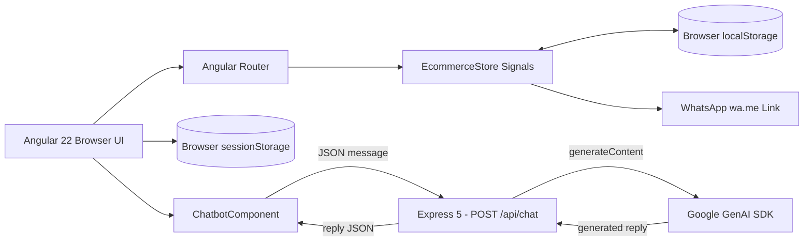

# NextBloom — Angular Jewelry Store with Gemini Support

NextBloom is a client-oriented storefront for handcrafted jewelry, with product browsing, cart and wishlist management, and WhatsApp-based checkout. It uses an Angular 22 frontend and an Express 5 backend that connects to Google Gemini through the `@google/genai` SDK.

      

## System Architecture & Data Flow



1. Angular lazy-loads routes such as `/products`, `/cart`, `/wishlist`, `/checkout`, `/chatbot`, and `/admin` from `app.routes.ts`.
2. `EcommerceStore` maintains products, cart items, and wishlist items with Angular signals and synchronizes them to `localStorage` keys `nextbloom_products`, `nextbloom_cart`, and `nextbloom_wishlist`.
3. Catalog, cart, wishlist, and checkout components read or update those signals. The checkout flow consumes a one-navigation in-memory access flag before accepting `/checkout` access.
4. `ChatbotComponent` sends `{ "message": text }` to `https://nextbloom-backend.vercel.app/api/chat`; the Express service calls `GoogleGenAI.models.generateContent` with `SYSTEM_INSTRUCTION` and returns `{ "reply": ... }`.
5. Checkout formats customer and cart details, then opens a `https://wa.me/923486527505` URL containing the order message. No payment or order persistence is performed in the application.

## Core Technical Components

| Component | Responsibility |
|---|---|
| Angular routing and standalone components | Lazy-loads the storefront, product, cart, wishlist, checkout, chatbot, admin, and not-found views. |
| `EcommerceStore` | Defines `Product`, `CartItem`, and `NewProductInput` types; manages signals, filtering, IDs, cart quantities, wishlist entries, checkout access, and browser persistence. |
| Product catalog and admin UI | Seeds product data in code, filters by category, renders product details, and supports add/delete operations through the in-browser store. |
| Cart and checkout | Computes subtotal and totals, validates checkout fields, and constructs a WhatsApp order URL. |
| `ChatbotComponent` and `VoiceService` | Posts chat messages to the backend and uses the browser Web Speech API for speech recognition and speech synthesis. |
| Express backend | Loads environment variables, initializes `@google/genai`, exposes `POST /api/chat`, and handles provider, quota, and configuration responses. |
| Browser storage | Uses `localStorage` for catalog, cart, and wishlist data and `sessionStorage` for the admin authentication flag. |

## Tech Stack

| Layer | Technology |
|---|---|
| Frontend framework | Angular `@angular/core`, `@angular/common`, `@angular/forms`, `@angular/platform-browser`, and `@angular/router` 22 |
| State and reactivity | Angular signals, computed signals, RxJS `~7.8.0` |
| Styling | Tailwind CSS `^4.1.12`, `@tailwindcss/postcss`, PostCSS `^8.5.3` |
| Language and build | TypeScript `~6.0.2`, `@angular/build`, `@angular/cli`, Angular application builder |
| Testing | Vitest `^4.0.8`, JSDOM `^28.0.0`, Angular unit-test builder |
| Deployment tooling | `angular-cli-ghpages ^3.1.0` for the frontend; Vercel `@vercel/node` configuration for the backend |
| Backend runtime | Node.js ECMAScript modules, Express `^5.2.1`, CORS `^2.8.6`, dotenv `^17.4.2` |
| AI integration | `@google/genai ^2.13.0`; default model `gemini-3.6-flash` |

## Project Structure

```text
NextBloom/
├── README.md
├── nextbloom-store/
│   ├── src/
│   │   ├── app/
│   │   │   ├── pages/
│   │   │   │   ├── admin/
│   │   │   │   ├── cart/
│   │   │   │   ├── categories/
│   │   │   │   ├── landing/
│   │   │   │   ├── place-order/
│   │   │   │   ├── policies/
│   │   │   │   ├── product-detail/
│   │   │   │   ├── product-grid/
│   │   │   │   └── wishlist/
│   │   │   ├── services/voice.ts
│   │   │   ├── shared/
│   │   │   │   ├── chatbot/
│   │   │   │   ├── footer/
│   │   │   │   └── header/
│   │   │   ├── store/ecommerce.store.ts
│   │   │   ├── app.routes.ts
│   │   │   └── app.config.ts
│   │   ├── assets/images/
│   │   ├── environments/
│   │   └── styles.css
│   ├── angular.json
│   ├── proxy.conf.json
│   └── package.json
└── nextbloom-backend/
    ├── server.js
    ├── vercel.json
    └── package.json
```

## Local Setup & Environment Variables

### Prerequisites

- Node.js and npm compatible with the Angular 22 toolchain
- A Google Gemini API key for live chatbot responses
- A modern browser for SpeechRecognition and SpeechSynthesis features

### Frontend

```powershell
cd nextbloom-store
npm install
npm start
```

The Angular development server uses `proxy.conf.json`, which proxies `/api` to `https://nextbloom-backend.vercel.app`. The chatbot component currently calls the production backend URL directly.

```powershell
npm run build
npm test
npm run watch
```

### Backend

Create `nextbloom-backend/.env` with only the variables referenced by `server.js`:

```dotenv
PORT=3000
GEMINI_API_KEY=
GEMINI_MODEL=gemini-3.6-flash
DEBUG_CHAT_ERRORS=false
```

Then start the backend:

```powershell
cd nextbloom-backend
npm install
node server.js
```

`GEMINI_API_KEY` is required for `POST /api/chat`; without it, the endpoint returns HTTP 503. `GEMINI_MODEL` is optional and defaults to `gemini-3.6-flash`. `DEBUG_CHAT_ERRORS=true` adds provider error details to backend 500 and fallback responses. `PORT` is optional and defaults to `3000`.

## Limitations & Future Work

- Product, cart, and wishlist data are stored only in browser `localStorage`; the repository has no database, server-side catalog, or cross-device synchronization.
- Admin access uses `environment.adminPanelPassword` and a `sessionStorage` flag, so it is client-side authentication and should not be treated as authorization for protected server operations.
- Orders are transferred through a preformatted WhatsApp URL. The system has no order database, payment integration, inventory reduction, or server-side order confirmation.
- The Gemini integration uses a single `POST /api/chat` request and has no persistent conversation history or authenticated per-user chat state; quota failures return a fixed fallback response.
